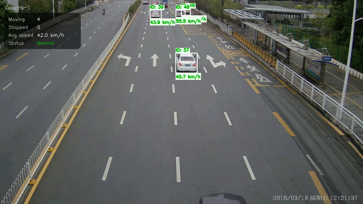

# Intelligent Traffic Behaviour Analysis

Detects vehicles in traffic-camera footage, tracks them with a multi-object tracker built from scratch, estimates each vehicle's real-world speed, and flags stopped vehicles and congestion.



*Demo footage: Sysvideo (YouTube). See [Credits](#credits).*

## What it does

- Detects cars, buses and trucks with YOLOv8
- Gives each vehicle a persistent ID using a custom tracker (IoU matching, Kalman filter, Hungarian assignment)
- Converts image positions to road-plane meters with a homography and estimates speed in km/h with a per-vehicle Kalman filter
- Flags vehicles stopped for more than 3 seconds and labels traffic as Normal, Slow Traffic or Congested


## How it works

1. **Detect.** YOLOv8n (pretrained on COCO) finds cars, buses and trucks in each frame.
2. **Track.** My own multi-object tracker gives each vehicle a persistent ID. Every track carries a constant-velocity Kalman filter that predicts where its box will be next. The predictions are compared with the new detections using IoU, and the Hungarian algorithm picks the best one-to-one matching. A new track is only reported once it has been matched on consecutive frames (`min_hits`, 10 in my runs), which removes one-frame false detections and duplicate "ghost" boxes. A lost vehicle is kept alive for up to 5 frames so short occlusions don't change its ID.
3. **Locate on the road.** The bottom-centre of each box (where the vehicle touches the ground) is mapped from image pixels to meters on the road plane using a homography computed from four hand-picked reference points.
4. **Estimate speed.** A second Kalman filter per vehicle works in road coordinates (meters) with the real time step between frames, and its velocity estimate gives the speed in km/h. On the sample clip it was visibly steadier than plain distance/time with exponential smoothing, though I haven't quantified this yet.
5. **Interpret behaviour.** A vehicle below 10 km/h for more than 3 seconds is flagged as stopped. With 7 or more tracked vehicles, an average speed of 20 km/h or less is labelled *Congested*, 40 km/h or less *Slow Traffic*, and anything else *Normal*.

## What I built vs. what I used

I built this to understand how tracking and speed estimation actually work, not to beat existing trackers. `main_custom_tracker.py` uses my own tracker, and `main.py` runs the same pipeline with Ultralytics' built-in BoT-SORT so the two can be compared.

**Written by me:** IoU computation, the Kalman filter, the per-object tracker, the multi-object tracker (association, track lifecycle, confirmation), the homography-based speed pipeline, and the stopped-vehicle and congestion rules, and other analytics logic.

**Used from libraries:** pretrained YOLOv8n weights (Ultralytics), OpenCV (video I/O, drawing, homography estimation), and SciPy's `linear_sum_assignment` for the Hungarian algorithm.

## Getting started

```bash
git clone https://github.com/LordChiiz/Intelligent-Traffic-Behaviour-Analysis.git
cd Intelligent-Traffic-Behaviour-Analysis
pip install -r requirements.txt
python main_custom_tracker.py
```

Press `q` to quit. The annotated video is also saved as `demo_output.mp4`. Tested on Windows with Python 3.13.2.

- `python main.py` runs the same pipeline with the built-in BoT-SORT tracker.
- The sample clip `traffic.mp4` is included (see [Credits](#credits)).
- To use another video, recalibrate for its camera view:
  1. Set `VIDEO_PATH` in `point_picker.py` and `video_path` in the main script to your video.
  2. Run `python point_picker.py`, click four corners of a rectangle on the road in the order top-left, top-right, bottom-right, bottom-left (pick one whose real size you can estimate, such as from lane widths), then press `q`.
  3. Paste the `IMAGE_POINTS` saved in `calibration_points.txt` into `calibration.py`, and set `WORLD_POINTS` to the rectangle's real size in meters, in the same corner order.

## Limitations

- **Speeds are approximate.** The calibration is manual and specific to this camera view. The road size (17.5 m × 100 m) is estimated from lane widths and dash spacing, and the speeds are plausible but haven't been checked against ground truth such as radar or GPS.
- **Each new vehicle starts at 0 km/h** and its speed takes a moment to settle.
- **Only cars, buses and trucks are tracked.** Motorcycles and scooters are ignored, and the small YOLOv8n model sometimes misses or duplicates detections.
- **Confirmation adds a delay.** With `min_hits` at 10, a vehicle appears about a third of a second after entering the frame at 30 fps.
- **Matching uses box overlap only**, with no appearance features, so IDs can switch in heavy occlusion. The tracker hasn't been benchmarked on a standard dataset or compared quantitatively with BoT-SORT.


## Credits

**Sample footage (`traffic.mp4`):** "Sysvideo 4k 8 Megapixel IP Camera Demo traffic car" by Sysvideo on YouTube, https://youtu.be/eO19UTm93GQ. The video belongs to its creator and is included only to demonstrate this project. It is not my work. If you are the rights holder and would like it removed, please contact me through my GitHub profile and I will take it down.

**Built with:** Ultralytics YOLOv8, OpenCV, NumPy, SciPy.
